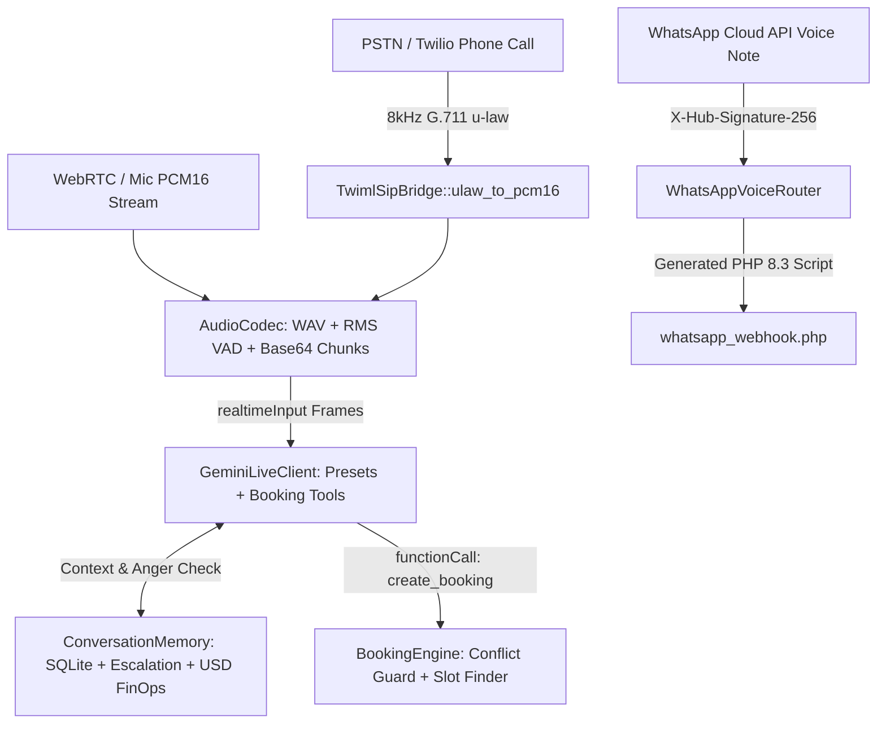

# 🎙️ Nemr Voice Flow `v3.0.0` (Sovereign Edition)

### *Realtime Gemini 3.8 Live API Voice Agent, Pure-Stdlib PCM16/WAV/G.711 μ-law Audio Codecs, TwiML Telephony Bridge, Escalation Memory & Conflict-Checked SQLite Booking Suite*

[](https://github.com/ElNeMeR70/nemr-voice-flow/releases)
[](https://python.org)
[](core/twiml_sip_bridge.py)
[](tests/test_voice_flow.py)
[](LICENSE)

---

## 📖 Executive Overview | نظرة عامة معمّقة

**English:**  
**Nemr Voice Flow** is an end-to-end engineering framework for building production Arabic and English conversational voice agents over **Gemini 3.8 Live API WebSockets**, **Twilio Telephony / SIP Media Streams**, and **WhatsApp Business Cloud API**. With zero external audio libraries (zero `audioop` deprecation issues on Python 3.13+), it handles PCM16 <-> RIFF WAV framing, ITU-T G.711 μ-law 8kHz telephony transcoding, RMS Voice Activity Detection (VAD), Meta HMAC webhook security, SQLite multi-turn memory with anger escalation detection, USD FinOps metering, and time-overlap-proof appointment booking.

**بالعربية (الشرح الهندسي الكامل):**  
منظومة **`nemr-voice-flow`** بتبني البنية التحتية الكاملة لموظفي الاستقبال الصوتيين بالذكاء الاصطناعي وروبوتات الرسائل الصوتية على الواتساب والتليفون باللهجة المصرية والسعودية والإنجليزية — **بدون الاعتماد على أي مكتبات خارجية**. الأداة بتدعم تحويل الصوت اللحظي بين **PCM16 / WAV / G.711 μ-law (8kHz)** المتوافق مع سنترالات التليفون و **Twilio Media Streams**، وتجهيز إطارات WebSocket لبث **Gemini 3.8 Live API** مع تعريف أدوات الحجز (`functionDeclarations`)، والتحقق من تواقيع ميتا (`X-Hub-Signature-256`)، وتوليد ملف Webhook جاهز بلغة **PHP 8.3**، مع ذاكرة حوار SQLite تكشف غضب العميل لتحويله فوراً لموظف بشري ومحرك حجوزات يمنع تضارب المواعيد نهائياً.

---

## 🏗️ System Architecture | معمارية النظام



---

## 🔬 Deep Dive into Core Engines | شرح تفصيلي للمحركات الداخلية

### 1. Pure-Stdlib Telephony Codec & TwiML SIP Bridge ([`core/twiml_sip_bridge.py`](core/twiml_sip_bridge.py))
Python 3.13 removed the legacy C module `audioop`. `TwimlSipBridge` implements the full **ITU-T G.711 μ-law logarithmic companding algorithm** in pure Python (`struct` + bitwise operations, bias `0x84 = 132`, clip `32635`), enabling bidirectional 8kHz telephony audio <-> 16-bit signed linear PCM transcoding with zero external dependencies:
- **`pcm16_to_ulaw()` / `ulaw_to_pcm16()`**: Exact exponent + 4-bit mantissa compression/expansion compatible with Twilio Media Streams (`audio/x-mulaw`) and Asterisk/SIP gateways.
- **`generate_twiml_stream()`**: Escapes XML attributes safely and produces `<Response><Say language="ar-EG">...</Say><Connect><Stream url="wss://..."/></Connect></Response>`.

### 2. Real-Time PCM16/WAV Framing & Energy VAD ([`core/audio_codec.py`](core/audio_codec.py))
- **WAV Roundtrip (`pcm16_to_wav_bytes`, `wav_bytes_to_pcm16`)**: Wraps raw 16-bit PCM into valid RIFF `.wav` headers and extracts metadata (`sample_rate`, `channels`, `sample_width`, `duration_ms`).
- **Base64 Chunking (`chunk_pcm_base64`)**: Slices PCM streams into fixed-millisecond frames aligned strictly to 16-bit even byte boundaries.
- **RMS & dBFS Voice Activity Detection (`detect_voice_activity`)**: Calculates Root-Mean-Square signal energy and decibels full-scale (`dBFS`) locally to filter silence before burning LLM streaming tokens!

### 3. Multi-Turn SQLite Memory, Anger Escalation & FinOps Estimator ([`core/conversation_memory.py`](core/conversation_memory.py))
- **`ConversationMemory`**: Persists caller turn history (`caller_id`, `role`, `content`, `intent`, `audio_sec`) in SQLite and retrieves bounded context windows (`get_context_window(max_turns=10)`).
- **Arabic & English Escalation Guard (`detect_escalation`)**: Scans transcripts for frustration or supervisor handoff phrases (`شكوى`, `مشكلة كبيرة`, `مدير`, `نصب`, `غلط`, `حولني لموظف`, `موظف بشري`, `refund`, `human agent`, `complaint`) and signals live call transfer immediately.
- **Audio+Text FinOps Estimator (`estimate_session_cost`)**: Computes exact audio input/output tokens (`25 tokens/sec`) plus text tokens to forecast call USD cost before scaling.

### 4. Gemini 3.8 Live Persona Presets & Tool Calling ([`core/gemini_live_client.py`](core/gemini_live_client.py))
Ships 4 battle-tested business personas (`clinic_eg`, `ecommerce_eg`, `concierge_sa`, `saas_en`) plus structured `functionDeclarations` (`check_available_slots`, `create_booking`, `cancel_booking`) and `build_tool_response_frame()` for bidirectional tool execution during live voice streaming.

### 5. Meta HMAC Security, Interactive Buttons & SQLite Slot Guard
- **[`core/whatsapp_voice_router.py`](core/whatsapp_voice_router.py)**: Implements constant-time Meta `X-Hub-Signature-256` (`hmac.compare_digest`), interactive reply button builders (enforcing Meta's 3-button / 20-char limits), and exports a complete **PHP 8.3 webhook handler** (`export-php-webhook`).
- **[`core/booking_engine.py`](core/booking_engine.py)**: Checks time-window interval overlaps (`req_start < ex_end and ex_start < req_end`) in SQLite so two callers can never double-book overlapping appointments, and generates open 30-minute time slots (`get_available_slots`).

---

## 💻 Complete CLI Reference Manual | مرجع الأوامر الكامل

| Command | Arguments & Flags | Purpose |
| :--- | :--- | :--- |
| `personas` | `[--preset clinic_eg\|ecommerce_eg\|concierge_sa\|saas_en] [--with-tools]` | Inspect personas or output Gemini Live WebSocket setup JSON |
| `twiml` | `--wss <wss://...> [--greeting "..."] [--language ar-EG]` | Generate Twilio Media Streams TwiML XML |
| `cost-estimate` | `--in-sec <float> --out-sec <float> [--text-tokens 500] [--json]` | Calculate voice token burn & session USD cost |
| `escalation-check` | `"<transcript>" [--json]` | Check transcript for Arabic/English human-handoff triggers |
| `booking` | `--phone <str> --name <str> --service <str> --date "<YYYY-MM-DD HH:MM:SS>" [--db file.db]` | Book slot with conflict protection + print MySQL DDL |
| `slots` | `--date <YYYY-MM-DD> [--db file.db]` | List available 30-minute appointment slots |
| `whatsapp-scaffold` | — | Preview WhatsApp incoming audio & interactive button payloads |
| `export-php-webhook` | `[--verify-token ...] [--out webhook.php]` | Export signature-verified PHP 8.3 WhatsApp webhook script |
| `simulate-call` | `"<query>" [--preset ...]` | Simulate conversational voice turn detection |
| `--version` | — | Print exact package version (`3.0.0`) |

### Terminal Walkthrough Examples

```bash
# 1. Generate Twilio TwiML XML bridging a phone call to Gemini Live WebSocket
python cli.py twiml --wss wss://voice.elnemer-ai.com/stream --greeting "أهلاً بك في عيادات النمر، كيف أساعدك اليوم؟"

# 2. Emit WebSocket setup JSON with Egyptian clinic persona + booking tools
python cli.py personas --preset clinic_eg --with-tools

# 3. Check transcript for escalation before continuing automated AI response
python cli.py escalation-check "عندي مشكلة كبيرة وعايز أحولني لموظف" --json

# 4. Book a conflict-checked appointment slot & inspect remaining open slots
python cli.py booking --phone "201012345678" --name "محمود النمر" --service "استشارة" --date "2026-11-20 14:00:00" --db clinic.db
python cli.py slots --date 2026-11-20 --db clinic.db

# 5. Export production PHP 8.3 Meta webhook script with X-Hub-Signature-256 verification
python cli.py export-php-webhook --out api/whatsapp_webhook.php
```

---

## 🐍 Programmatic Python API Usage

```python
from core import GeminiLiveClient, PERSONA_PRESETS, TwimlSipBridge, AudioCodec, ConversationMemory, BookingEngine

# 1. Transcode 8kHz Twilio G.711 u-law payload -> PCM16 -> RMS Voice Activity Check
ulaw_payload = b"\xff\x7f\xfe" * 200
pcm16_audio = TwimlSipBridge.ulaw_to_pcm16(ulaw_payload)
vad = AudioCodec.detect_voice_activity(pcm16_audio, threshold_rms=250.0)

# 2. Log turn & guard against angry customer escalation
mem = ConversationMemory("calls.db")
esc = mem.detect_escalation("عايز أكلم المدير فوراً")
if not esc["escalate"]:
    client = GeminiLiveClient(config=PERSONA_PRESETS["clinic_eg"])
    setup_frame = client.build_setup_message(include_tools=True)
    frame_chunks = AudioCodec.chunk_pcm_base64(pcm16_audio, chunk_ms=100, sample_rate=8000)

# 3. Schedule conflict-checked appointment
engine = BookingEngine("clinic.db")
record = engine.create_booking("201099990000", "سارة أحمد", "كشف", "2026-11-20 11:00:00")
```

---

## 📦 Installation & AI Agent Integration

```bash
git clone https://github.com/ElNeMeR70/nemr-voice-flow.git
cd nemr-voice-flow
pip install -e .
nemr-voice --version
```

Copy [`SKILL.md`](SKILL.md) to `~/.gemini/config/skills/nemr-voice-flow/SKILL.md` for global Antigravity AI agent availability.

---

## 🎚️ Audio Encoding, Latency & Bandwidth Reference | مواصفات الصوت والشبكة

| Transport Pipeline | Codec Format | Sample Rate | Bit Depth / Frame | Bitrate | Primary Use Case |
| :--- | :--- | :--- | :--- | :--- | :--- |
| **Gemini Live Uplink** | Linear PCM (`audio/pcm`) | `16,000 Hz` | 16-bit Signed Mono | `256 kbps` | Browser mic / WebRTC live capture |
| **Gemini Live Downlink** | RIFF WAV / Linear PCM | `24,000 Hz` | 16-bit Signed Mono | `384 kbps` | High-fidelity natural Arabic synthesis |
| **Twilio Media Streams / SIP** | ITU-T G.711 μ-law | `8,000 Hz` | 8-bit Companded Mono | `64 kbps` | Egyptian & international PSTN calls |
| **WhatsApp Business Cloud** | OGG / Opus | `16,000 Hz` | Variable VBR Voice | `~24 kbps` | Asynchronous WhatsApp voice notes |

### How Pure-Python ITU-T G.711 μ-law Works Without `audioop`
Starting in Python 3.13, `import audioop` was removed from the standard library. `TwimlSipBridge` implements genuine IEEE/ITU-T G.711 logarithmic companding (`BIAS = 0x84`, `CLIP = 32635`):
1. **Compression (`pcm16_to_ulaw`)**: Extracts the sign bit, takes magnitude + `132` bias, finds the highest set exponent bit (`0..7`) + top `4` mantissa bits, and bitwise-inverts (`~u & 0xFF`).
2. **Expansion (`ulaw_to_pcm16`)**: Unpacks sign/exponent/mantissa back into 16-bit signed PCM integers using zero-lookup bit shifts, keeping end-to-end call transcoding latency sub-millisecond.

### Persona & Escalation Architecture (هندسة التصعيد والحماية)
Every inbound caller message passes through `ConversationMemory.detect_escalation()` **before** invoking an LLM turn. If Arabic frustration/handoff triggers (`شكوى`, `مشكلة كبيرة`, `مدير`, `نصب`, `حولني لموظف`) or English keywords (`refund`, `complaint`, `human agent`) appear, the orchestrator flags an immediate warm transfer to a human representative while preserving the SQLite transcript context window.

---

## 📊 Feature Comparison

| Feature | Generic Chatbot Script | Cloud SaaS Builders | **Nemr Voice Flow v3.0** |
| :--- | :---: | :---: | :---: |
| Pure Python Telephony μ-law + TwiML | ❌ | SaaS Lock-in | ✅ Pure Stdlib |
| Arabic Dialect Personas (`ar-EG` / `ar-SA`) | Prompt Only | Limited | ✅ Built-in + Booking Tools |
| SQLite Overlap-Proof Slot Scheduling | ❌ | Extra Service | ✅ Native Interval Check |
| Meta HMAC `X-Hub-Signature-256` PHP Webhook | ❌ | ❌ | ✅ One-Click Export |
| Session Audio Token & USD FinOps Estimator | ❌ | ❌ | ✅ Real-Time Estimate |

### Architectural Edge Cases & Production Safety Guarantees (ضمانات التشغيل الإنتاجي)
1. **Even-Byte Audio Frame Alignment**: Base64 WebSocket streaming (`AudioCodec.chunk_pcm_base64`) clamps slice lengths to multiples of 2 bytes so 16-bit PCM sample pairs never split mid-sample across WebSocket packets.
2. **Windowed Conflict Interval Math**: Unlike naive exact-timestamp string equality checks, `BookingEngine` evaluates `[req_start < existing_end AND existing_start < req_end]` in SQLite so 30-minute appointments never collide at `:15` or `:45` minute offsets.
3. **Zero Timing-Attack Webhook Security**: Meta `X-Hub-Signature-256` verification uses `hmac.compare_digest` in Python and `hash_equals` in exported PHP 8.3 code, mitigating signature timing side-channels.
4. **Meta Interactive Payload Compliance**: `build_interactive_buttons` enforces Meta Cloud API limits (1–3 buttons, `<= 20` characters per reply title) before network dispatch to prevent HTTP 400 webhook drops.

### Directory Structure | هيكل المشروع

```text
nemr-voice-flow/
├── core/
│   ├── __init__.py                 # Public v3.0.0 exports
│   ├── audio_codec.py              # PCM16 <-> RIFF WAV framing, base64 chunks & RMS VAD
│   ├── twiml_sip_bridge.py         # Twilio TwiML XML + pure-Python G.711 u-law codec
│   ├── gemini_live_client.py       # WebSocket setup, 4 Arabic/EN personas & function tools
│   ├── conversation_memory.py      # SQLite transcript store, escalation check & USD FinOps
│   ├── whatsapp_voice_router.py    # Meta HMAC SHA-256 verification & PHP 8.3 webhook export
│   └── booking_engine.py           # Conflict-guarded SQLite slot scheduler & slot finder
├── tests/
│   └── test_voice_flow.py          # 13 comprehensive stdlib unit tests
├── cli.py                          # `nemr-voice` CLI entry point (--version 3.0.0)
├── pyproject.toml                  # PEP 621 zero-dependency packaging
├── SKILL.md                        # Antigravity AI agent skill definition
└── LICENSE                         # MIT License
```

### Pipeline Latency & Real-Time Deployment Tips (نصائح التشغيل الفعلي)
- **WebSocket Frame Pacing**: Stream 100ms chunks (`3200 bytes` at `16kHz PCM16`) continuously using `AudioCodec.chunk_pcm_base64()` while dropping silent pauses below `rms < 300.0` via `detect_voice_activity()` to reduce upstream bandwidth and token cost.
- **Hostinger LiteSpeed PHP Webhooks**: Deploy the output of `nemr-voice export-php-webhook` directly behind Hostinger HTTPS, configuring `WA_VERIFY_TOKEN` and `WA_APP_SECRET` in `.env` so signature verification never blocks legitimate Meta callbacks while rejecting spoofs with HTTP `401`.

---

## 🧪 Verification & Tests

```bash
python -m unittest discover -s tests -v
# Ran 13 tests in 0.03s — OK
```

MIT License — Copyright (c) 2026 [Mahmoud ElNeMeR](https://elnemer-ai.com)
